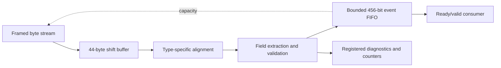

# Design and verification notes

## Data path

The decoder accepts one byte per cycle when output capacity is available.
On the last byte it validates type length and enums, aligns the payload and
enqueues the normalized event. There is no speculative event before EOP.
The FIFO is intentionally shallow and register-based. The full packed event
makes integration and verification straightforward, at an area cost.

With an empty FIFO and an accepting sink, the first output handshake is one
clock after the last input-byte handshake. From the first byte of a 36-byte
A message to that output handshake, it is 36 clocks. Output blocking makes
handshake latency unbounded unless the system specifies a bound on stalls.

## Reference and scoreboard

The Python payload model decodes explicit big-endian byte slices. Fixtures
are built independently with `struct`, including a hand-written golden A
message and independently stated expected fields. The stream reference uses
a byte list; RTL uses a shift register and type-specific fixed alignment.
No HDL is generated from the Python parser.

The SystemVerilog testbench obeys the input hold contract while randomizing
source gaps and sink readiness. It records accepted input and all output
cycles. A Python scoreboard checks every output field, including while
blocked, ordering, loss/duplication, exact ready behavior, diagnostic pulses,
statistics and reset flushing. It verifies the test driver's hold behavior
as well, so malformed ready/valid stimulus cannot silently justify failures.

Campaigns include all eight types, zero/max numeric bit patterns, every
representable short length, excess lengths, invalid enums, every unsupported
type byte, oversized frames, stray input, restart, abort with valid asserted,
reset during a partial frame, and reset with a deliberately full FIFO.
Depths 1, 3 and 4 cover replacement at depth one and non-power-of-two pointer
wrap. Random runs use recorded seeds. A separate uninterrupted A-message run
measures active-window throughput and post-frame handshake latency.

These are simulation and static checks, not an exhaustive formal proof.

## Implementation experiment

The core's 456-bit output is too wide for direct attachment to most small
FPGA packages. `bench/synthesis_top.sv` folds all event fields and counters
into a registered digest sink, leaving a narrow external interface. The
digest prevents unobserved fields from simply disappearing, but is not an
event transport or cryptographic checksum.

Yosys maps this harness and the depth-four decoder to iCE40 primitives.
nextpnr places/routes for HX8K-CT256 with seed 1 and a 50 MHz clock target.
Automatic pin assignment is explicitly enabled. There is no board pinout or
external input/output delay model; reported frequency is an internal timing
estimate for this harness. It does not establish complete interface timing
closure or physical-board operation.

The [generated measurements](../results/README.md) give the mapped LUT/FF,
routed logic-cell use, and internal-clock estimate against the 50 MHz target.
See machine-readable results for exact tool versions and design hashes.
Counts/frequency can vary with tools, seed, wrapper and FIFO depth.

At the validated 50 MHz target, cycle scaling gives 50 MB/s (400 Mbit/s) of
payload bytes and 1.389 million 36-byte A messages/s without stalls. These
are arithmetic projections from simulation and timing, not measured network
or board throughput. There is no Ethernet or transport overhead model here.

## Trade-offs and integration work

The byte interface favors a manageable, verifiable implementation over line
rate at multi-gigabit links. A wider input needs packing, cross-word fields,
multiple messages per beat and more complex backpressure semantics.
The register FIFO and normalized event layout cost area; a tagged union or
deeper RAM-backed queue could reduce that cost, but must retain identical
observable semantics. A real deployment also needs transport sequencing,
gap recovery, session/directory handling, clock/reset integration, board I/O
constraints, and a stateful consumer. These are outside the implemented
payload-decoder boundary, not features claimed by this repository.

## Development provenance

This is a new portfolio implementation. It contains no employer firmware or
copied course solution. Reproducible tests and implementation reports are included.
The technical choices, limitations and guide are intended to make the design
reviewable and explainable rather than rely on an unverified README claim.
